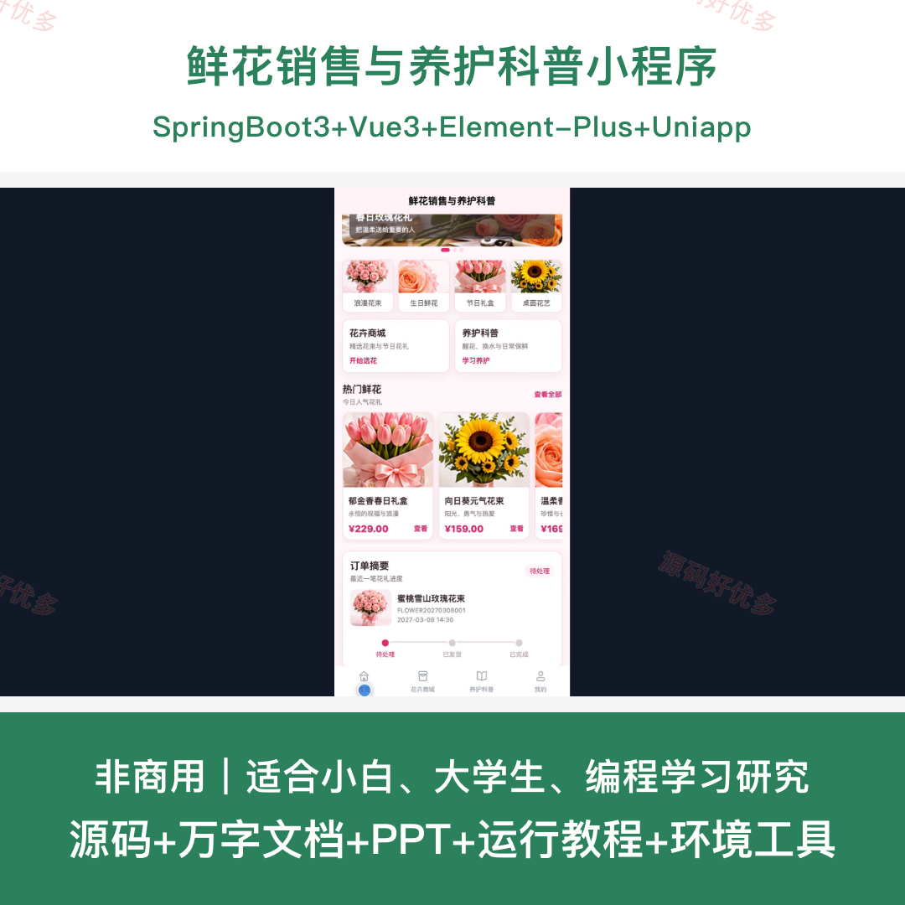
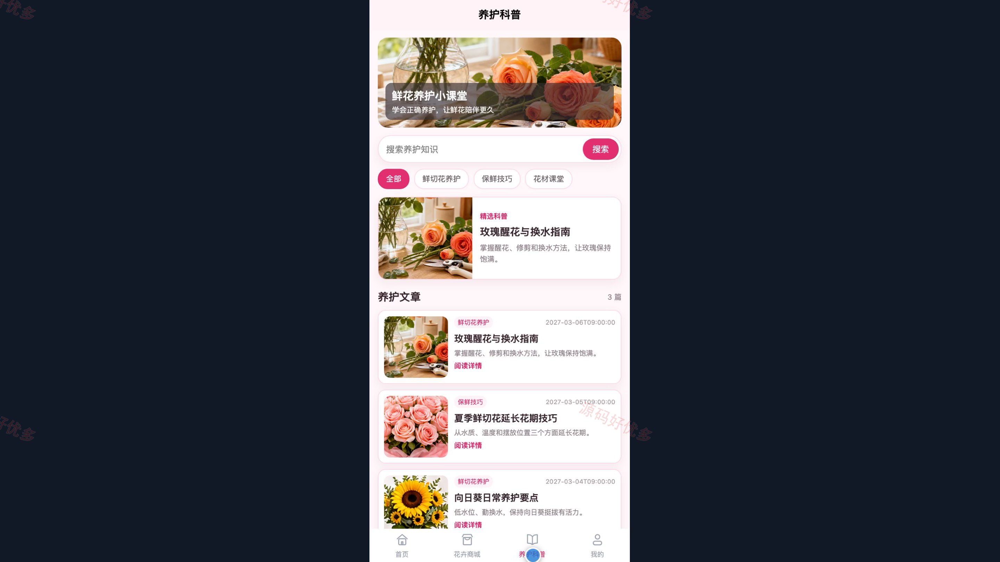
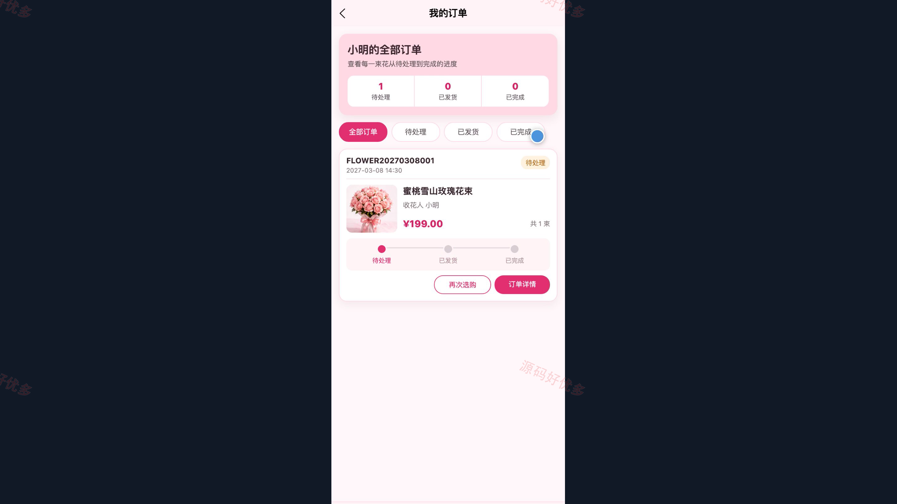
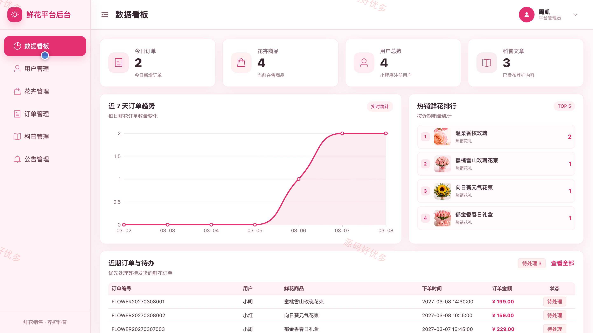
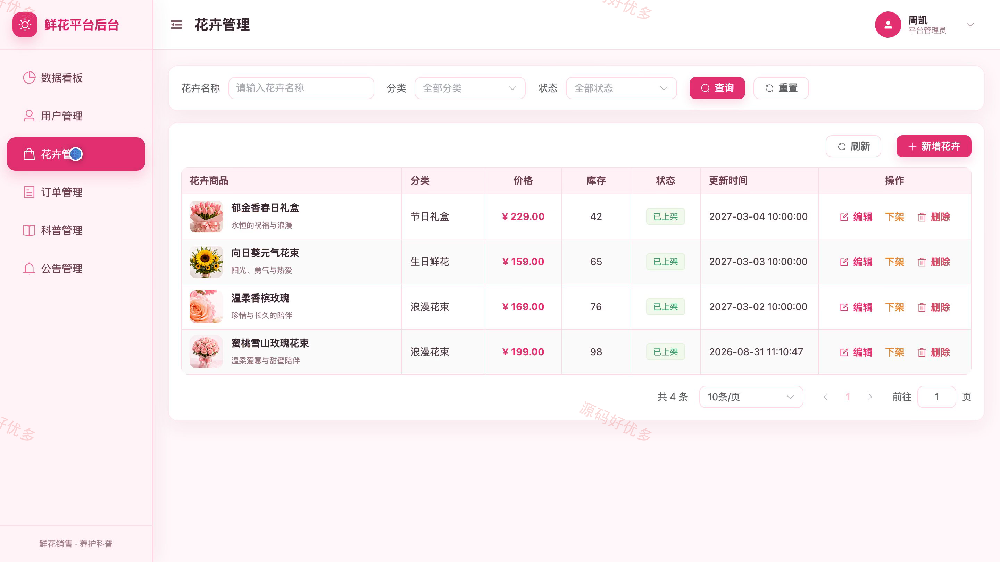
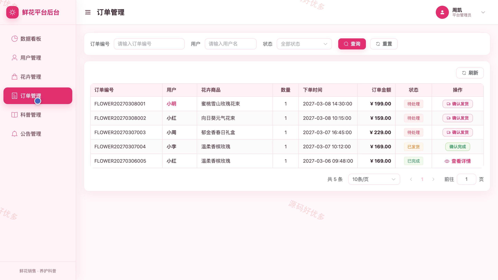

# bs049B
bs049B鲜花销售与养护科普小程序源码 Java SpringBoot3 Vue3 文档 PPT
## 源码问题查看主页咨询

### 一、关键词
鲜花商城、花礼订购、花卉养护、鲜切花科普、购物车结算、订单履约

### 二、作品包含
源码+数据库+万字设计文档+PPT+全套环境和工具资源+本地部署教程

### 三、项目技术
前端技术： Html、Css、Js、Vue3.4、Element-Plus、uniapp
后端技术：Java、SpringBoot3.2.5

### 四、运行环境要求
开发工具：IDEA/eclipse + VSCODE + HBuilder X + 微信开发者工具

数据库：MySQL5.7+（共10张表）

数据库管理工具：Navicat10以上版本

环境配置软件： JDK17 + Maven3.6

前端Nodejs：18

浏览器：谷歌浏览器

### 五、项目介绍
项目编号：bs049B

本系统面向鲜花线上销售和日常养护知识传播，用户通过小程序完成花卉检索、购物车结算、收花信息提交、订单跟踪与养护文章阅读；管理员通过后台维护用户、商品、订单、科普内容和公告，并通过经营看板掌握销售与内容数据。系统在下单时校验商品状态和库存并执行库存扣减，形成从内容引导、商品选购到订单履约的业务闭环。

角色：用户、管理员

用户功能：账号注册登录与资料维护、首页热门内容与搜索导航、花卉搜索筛选与详情查看、购物车勾选及数量调整和删除结算、收花信息填写与立即购买、订单状态筛选与详情查看、养护科普检索与正文阅读。

管理员功能：管理员登录与会话管理、经营数据看板并查看趋势与热销排行、用户查询与账号启禁、花卉分类及商品维护与上下架、订单查询及详情查看与履约状态推进、养护科普发布和草稿编辑及删除、公告发布与编辑及启停删除。

### 六、运行截图

